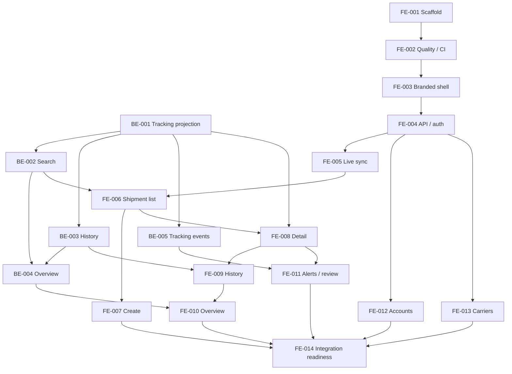

# Frontend v1 implementation tickets

FE-V1-001 is **Implemented, locally verified, and committed**. See
its [implementation summary](../implementation-summary/FE-V1-001-implementation-summary.md).
FE-V1-002 is **Implemented, locally verified, and committed**; GitHub-hosted
execution remains pending. See its
[implementation summary](../implementation-summary/FE-V1-002-implementation-summary.md).
FE-V1-003 is **Implemented and locally verified**; its commit remains pending
explicit approval. See its
[summary](../implementation-summary/FE-V1-003-implementation-summary.md).
FE-V1-004 is **Implemented, locally verified, and committed**. See its
[summary](../implementation-summary/FE-V1-004-implementation-summary.md).
FE-V1-005 is **Implemented, locally verified, and committed**.
See its [summary](../implementation-summary/FE-V1-005-implementation-summary.md).
FE-V1-006 is implemented and locally verified; commit approval is pending.
See its [implementation summary](../implementation-summary/FE-V1-006-implementation-summary.md).
FE-V1-007 is implemented and locally verified; commit approval is pending.
See its [summary](../implementation-summary/FE-V1-007-implementation-summary.md).
FE-V1-008 is implemented, locally verified and committed on `feature/dashboard-v1`.
See its [summary](../implementation-summary/FE-V1-008-implementation-summary.md).
FE-V1-009 is implemented and locally verified; commit approval is pending.
See its [summary](../implementation-summary/FE-V1-009-implementation-summary.md).
FE-V1-010 is implemented and locally verified.
See its [summary](../implementation-summary/FE-V1-010-implementation-summary.md).
FE-V1-011 is implemented and locally verified; commit approval is pending.
See its [summary](../implementation-summary/FE-V1-011-implementation-summary.md).
FE-V1-012 is implemented, locally verified, and committed on `feature/dashboard-v1`.
See its [summary](../implementation-summary/FE-V1-012-implementation-summary.md).
BE-V1-001 is **Implemented, locally verified, and committed**; deployment is
pending. See its [summary](../../../../grd-dashboard-be/docs/v1/implementation-summary/BE-V1-001-implementation-summary.md).
BE-V1-002 is **Implemented and locally verified**; deployment is pending. See its
[summary](../../../../grd-dashboard-be/docs/v1/implementation-summary/BE-V1-002-implementation-summary.md).
BE-V1-003 is **Implemented and locally verified**; deployment is pending. See its
[summary](../../../../grd-dashboard-be/docs/v1/implementation-summary/BE-V1-003-implementation-summary.md).
BE-V1-004 is **Implemented and locally verified**; deployment is pending. See its
[summary](../../../../grd-dashboard-be/docs/v1/implementation-summary/BE-V1-004-implementation-summary.md).
BE-V1-005 is **Implemented and locally verified**; deployment is pending. See its
[summary](../../../../grd-dashboard-be/docs/v1/implementation-summary/BE-V1-005-implementation-summary.md).
Other ticket statuses are recorded in their individual files. Existing brand files
were inputs to FE-V1-003; its implementation evidence is recorded separately.
Execute a ticket only after its prerequisites are implemented and verified,
not merely documented.

Tickets follow the backend's Objective / Required reading / Scope / Acceptance
criteria / Verification structure. Use a focused branch and reviewable commit
scope per ticket where practical. This plan does not require parallel agents.

## Backend prerequisites — execute in `../grd-dashboard-be`

| Ticket                                             | Depends on           | Outcome                                                                                    |
| -------------------------------------------------- | -------------------- | ------------------------------------------------------------------------------------------ |
| [BE-V1-001](BE-V1-001-tracking-read-projection.md) | Existing backend v1  | Public snapshot identity, current tracking, latest completed lookup/latest run projection. |
| [BE-V1-002](BE-V1-002-shipment-search.md)          | BE-V1-001            | Additive paginated search, filters, stable sorting, tab counts.                            |
| [BE-V1-003](BE-V1-003-tracking-history.md)         | BE-V1-001            | Separate paginated normalized history API.                                                 |
| [BE-V1-004](BE-V1-004-overview-aggregates.md)      | BE-V1-002, BE-V1-003 | Consistent overview totals and attention/delivery/change panels.                           |
| [BE-V1-005](BE-V1-005-tracking-change-events.md)   | BE-V1-001            | Transactional precise tracking-change signal alongside existing SSE events.                |

## Frontend tickets — execute in this repository

| Ticket                                           | Depends on                   | Outcome                                                                              |
| ------------------------------------------------ | ---------------------------- | ------------------------------------------------------------------------------------ |
| [FE-V1-001](FE-V1-001-scaffold.md)               | Approved plan                | React/TypeScript/Vite/pnpm scaffold and feature boundaries.                          |
| [FE-V1-002](FE-V1-002-quality-and-ci.md)         | FE-V1-001                    | Quality tooling, hooks, CI, secret scan, smoke-test foundation.                      |
| [FE-V1-003](FE-V1-003-branded-shell.md)          | FE-V1-002                    | GRD shell, official assets, theme modes, responsive navigation, MUI notification host. |
| [FE-V1-004](FE-V1-004-api-and-auth.md)           | FE-V1-003, existing auth API | Axios/session infrastructure, sign-in, replacement, role guards, teardown.           |
| [FE-V1-005](FE-V1-005-live-synchronization.md)   | FE-V1-004                    | Single SSE lifecycle and race-safe cache invalidation.                               |
| [FE-V1-006](FE-V1-006-shipment-list.md)          | FE-V1-005, BE-V1-002         | Active-default tabbed list, server queries, URL state, quick row actions.            |
| [FE-V1-007](FE-V1-007-create-shipments.md)       | FE-V1-006                    | Inline single-shipment creation and immediate duplicate feedback.                    |
| [FE-V1-008](FE-V1-008-shipment-details.md)       | FE-V1-006, BE-V1-001         | Dedicated Overview detail, notes, delete, refresh/run feedback.                      |
| [FE-V1-009](FE-V1-009-shipment-history.md)       | FE-V1-008, BE-V1-003         | Dedicated detail History tab with pagination.                                        |
| [FE-V1-010](FE-V1-010-overview-homepage.md)      | FE-V1-009, BE-V1-004         | Problem-first homepage with server totals and useful drill-downs.                    |
| [FE-V1-011](FE-V1-011-alerts-and-review.md)      | FE-V1-008, BE-V1-005         | `/shipments`-only toasts/audio, persistent account-local review highlights.          |
| [FE-V1-012](FE-V1-012-account-administration.md) | FE-V1-004                    | Dedicated Admin account list/create/detail/reset flows.                              |
| [FE-V1-013](FE-V1-013-carrier-administration.md) | FE-V1-004                    | Dedicated Admin carrier list/settings and dependent-data invalidation.               |
| [FE-V1-014](FE-V1-014-integration-readiness.md)  | All preceding tickets        | Real-backend acceptance, browser/accessibility checks, CI completion, local handoff. |

## Dependency graph

## Suggested execution order

1. FE-V1-001–004 establish tooling, branding, and existing authentication.
2. BE-V1-001–005 supply the missing contracts; update both handoffs with evidence.
3. FE-V1-005–011 implement live shipments, history, overview, and alerts.
4. FE-V1-012–013 implement administration (they can be scheduled after auth).
5. FE-V1-014 verifies the complete system against the real local backend.

## Shared completion rule

Read [verification.md](../verification.md) and [agent-workflow.md](../agent-workflow.md).
Every ticket requires relevant format/lint/type/test/build checks for changed code
and its named integration evidence. If a check cannot run, state the exact blocker
and leave the verification limitation visible. Do not claim a missing API exists
because fixture tests passed. Summaries record the target repository, changes,
exact checks/results, relevant commit if approved, and unresolved limitations.

Publishing and deployment are explicitly deferred, not hidden jobs enabled on
main. Ticket completion does not grant commit approval. Brand assets must remain
traceable to their original sources.
